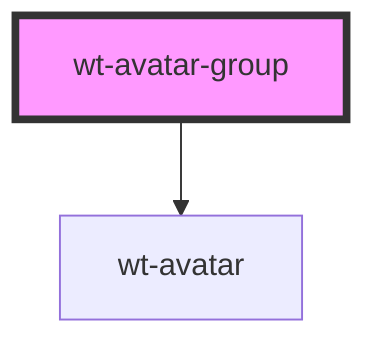

# wt-avatar-group

<!-- Auto Generated Below -->

## Properties

| Property | Attribute | Description | Type                             | Default    |
| -------- | --------- | ----------- | -------------------------------- | ---------- |
| `list`   | --        |             | `AvatarItem[]`                   | `[]`       |
| `max`    | `max`     |             | `number`                         | `5`        |
| `shape`  | `shape`   |             | `"circle" \| "square"`           | `"circle"` |
| `size`   | `size`    |             | `"large" \| "medium" \| "small"` | `"medium"` |

## Slots

| Slot | Description      |
| ---- | ---------------- |
|      | The default slot |

## Dependencies

### Depends on

- [wt-avatar](../wt-avatar)

### Graph

---

_Built with [StencilJS](https://stenciljs.com/)_
