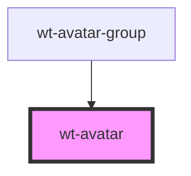

# wt-avatar

<!-- Auto Generated Below -->

## Properties

| Property | Attribute | Description | Type                             | Default    |
| -------- | --------- | ----------- | -------------------------------- | ---------- |
| `alt`    | `alt`     |             | `string`                         | `''`       |
| `shape`  | `shape`   |             | `"circle" \| "square"`           | `'circle'` |
| `size`   | `size`    |             | `"large" \| "medium" \| "small"` | `'medium'` |
| `src`    | `src`     |             | `string`                         | `''`       |
| `styles` | --        |             | `{ [key: string]: string; }`     | `{}`       |
| `text`   | `text`    |             | `string`                         | `'User'`   |

## Slots

| Slot | Description      |
| ---- | ---------------- |
|      | The default slot |

## Dependencies

### Used by

 - [wt-avatar-group](../wt-avatar-group)

### Graph

----------------------------------------------

*Built with [StencilJS](https://stenciljs.com/)*
