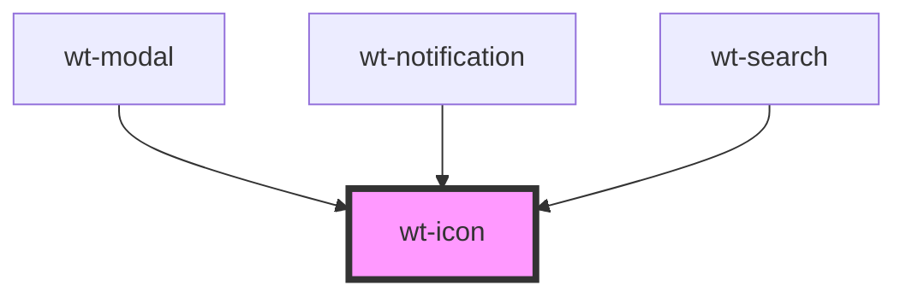

# wt-icon

<!-- Auto Generated Below -->

## Properties

| Property            | Attribute     | Description          | Type      | Default     |
| ------------------- | ------------- | -------------------- | --------- | ----------- |
| `classNames`        | `class-names` | 传入的class名称      | `string`  | `''`        |
| `color`             | `color`       | color 颜色           | `string`  | `""`        |
| `name` _(required)_ | `name`        | 字体图标名称         | `string`  | `undefined` |
| `rotate`            | `rotate`      | 旋转的角度           | `number`  | `0`         |
| `size`              | `size`        | icon 尺寸 默认 20    | `string`  | `""`        |
| `spin`              | `spin`        | 是否自动旋转         | `boolean` | `false`     |
| `styles`            | --            | styles 传入的css样式 | `object`  | `{}`        |

## Dependencies

### Used by

- [wt-modal](../wt-modal)
- [wt-notification](../wt-notification)
- [wt-search](../wt-search)

### Graph

---

_Built with [StencilJS](https://stenciljs.com/)_
