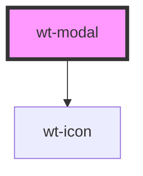

# wt-modal

<!-- Auto Generated Below -->

## Properties

| Property        | Attribute         | Description                                                                                  | Type                         | Default         |
| --------------- | ----------------- | -------------------------------------------------------------------------------------------- | ---------------------------- | --------------- |
| `beforeClose`   | --                | Function to call before closing the modal. If provided, the modal won't close automatically. | `(done: () => void) => void` | `undefined`     |
| `open`          | `open`            |                                                                                              | `boolean`                    | `false`         |
| `showCloseIcon` | `show-close-icon` |                                                                                              | `boolean`                    | `true`          |
| `showOverlay`   | `show-overlay`    |                                                                                              | `boolean`                    | `true`          |
| `titleText`     | `title-text`      |                                                                                              | `string`                     | `"Modal Title"` |
| `top`           | `top`             |                                                                                              | `string`                     | `"20%"`         |

## Events

| Event              | Description | Type                   |
| ------------------ | ----------- | ---------------------- |
| `updateModelValue` |             | `CustomEvent<boolean>` |
| `wt-open-change`   |             | `CustomEvent<boolean>` |

## Slots

| Slot        | Description |
| ----------- | ----------- |
| `"content"` |             |
| `"footer"`  |             |

## Dependencies

### Depends on

- [wt-icon](../wt-icon)

### Graph

---

_Built with [StencilJS](https://stenciljs.com/)_
