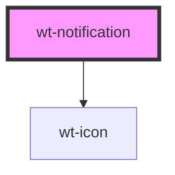

# wt-notification

<!-- Auto Generated Below -->

## Properties

| Property      | Attribute       | Description | Type                                                       | Default  |
| ------------- | --------------- | ----------- | ---------------------------------------------------------- | -------- |
| `actionLabel` | `action-label`  |             | `string`                                                   | `''`     |
| `isFullWidth` | `is-full-width` |             | `boolean`                                                  | `false`  |
| `message`     | `message`       |             | `string`                                                   | `''`     |
| `showClose`   | `show-close`    |             | `boolean`                                                  | `true`   |
| `titleText`   | `title-text`    |             | `string`                                                   | `''`     |
| `type`        | `type`          |             | `"error" \| "info" \| "primary" \| "success" \| "warning"` | `'info'` |

## Events

| Event       | Description | Type               |
| ----------- | ----------- | ------------------ |
| `wt-action` |             | `CustomEvent<any>` |
| `wt-close`  |             | `CustomEvent<any>` |

## Dependencies

### Depends on

- [wt-icon](../wt-icon)

### Graph

---

_Built with [StencilJS](https://stenciljs.com/)_
