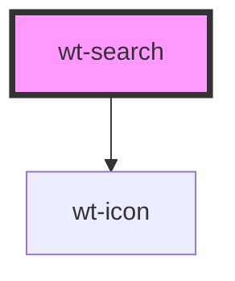

# wt-search

<!-- Auto Generated Below -->

## Properties

| Property       | Attribute       | Description                                     | Type                             | Default            |
| -------------- | --------------- | ----------------------------------------------- | -------------------------------- | ------------------ |
| `clearable`    | `clearable`     | 是否显示清除图标，默认 true                     | `boolean`                        | `true`             |
| `defaultValue` | `default-value` | React defaultValue                              | `string`                         | `''`               |
| `disabled`     | `disabled`      | 是否禁用组件                                    | `boolean`                        | `false`            |
| `modelValue`   | `model-value`   | v-model 绑定值（Vue）                           | `string`                         | `undefined`        |
| `placeholder`  | `placeholder`   | 输入框占位文本                                  | `string`                         | `'请输入搜索内容'` |
| `size`         | `size`          | 组件尺寸：small \| medium \| large，默认 medium | `"large" \| "medium" \| "small"` | `'medium'`         |
| `width`        | `width`         | 自定义宽度（px 值或 CSS 字符串）                | `string`                         | `undefined`        |

## Events

| Event              | Description                  | Type                  |
| ------------------ | ---------------------------- | --------------------- |
| `updateModelValue` | Vue v-model 同步事件         | `CustomEvent<string>` |
| `wt-clear`         | 清除事件                     | `CustomEvent<void>`   |
| `wt-input`         | 输入事件                     | `CustomEvent<string>` |
| `wt-search`        | 搜索事件（点击搜索区域触发） | `CustomEvent<string>` |

## Dependencies

### Depends on

- [wt-icon](../wt-icon)

### Graph

---

_Built with [StencilJS](https://stenciljs.com/)_
