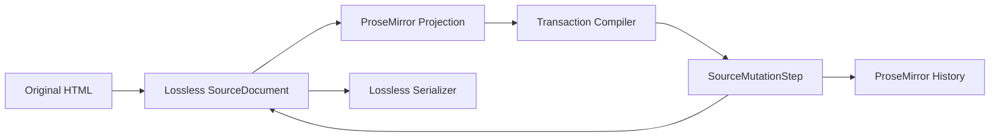

# Source-Aware Mutation Engine Progress

> Architecture update (2026-11-03): preserved from the retired html-editor package.
> Base engine/tests now live in lunar-editor-core; generic React adapters and math/table
> extensions live in lunar-editor-react. Redline Review, AI, PDF pages, product UI
> and integration tests live in [App](../../../app/src/editor/README.md).
> Historical test results below describe their original runner and are not a current
> full-suite result. See [Editor Core](../README.md) for current commands and known failures.

## Goal

Replace dirty-block HTML patching with a lossless, source-aware, reversible
mutation engine shared by Rich and Code modes.

## Original scope state (historical)

| Area | Status | Progress |
|---|---|---:|
| RFC and contracts | Done | 100% |
| Lossless source core | Done | 100% |
| ProseMirror source map | Done | 100% |
| Transaction/history integration | Done | 100% |
| Review/export migration | Done | 100% |
| Code/Rich session unification | Done | 100% |

## Overall Progress

`15 / 15 tasks done` - `100%` - `[####################]`

Documentation does not count as completed runtime capability.

## Recovery Entry Points

1. Read `docs/source-aware-mutation-engine-rfc.md`.
2. Read this file and `docs/source-aware-mutation-task-board.csv`.
3. Run `git status --short` and preserve unrelated changes.
4. The original task board is complete. Open follow-up work against the current
   [data flow](../../../LUNAR_EDITOR_DATA_FLOW.md) and [performance notes](../../../../docs/LUNAR_SOURCE_PERFORMANCE.md).
5. From `frontend`, run `pnpm --filter @mache-hangar/lunar-editor-core test` (or a focused Jest
   path) and `pnpm --filter @mache-hangar/lunar-editor-core typecheck`; build affected consumers
   when changing package boundaries or public APIs.

## Architecture Slice Map

## Phase Plan

| Phase | Scope | Exit Criteria | Status |
|---|---|---|---|
| 1 | Lossless model/parser/serializer/mutations | Exact round-trip and inverse tests pass | Done |
| 2 | ProseMirror source map | Element and text source mapping survives edits | Done |
| 3 | Transaction compiler/history | Cross-block edit Undo/Redo stays synchronized | Done |
| 4 | Review/export migration | Current patch fallback is removed safely | Done |
| 5 | Code/Rich session | Both modes update one source session | Done |

## Active Slice

`SA-015` is complete. All RFC capability slices are implemented. Future work
should be opened as a new RFC or a focused follow-up rather than extending this
completed task board implicitly.

## Original findings (historical)

Old source paths, text pieces and generated-event adapters in this table describe
the original phase. They have since been replaced or moved; use the linked
current data flow for implementation entry points.

| Finding | Evidence | Decision |
|---|---|---|
| Legacy dirty-block/review string patching can normalize or miss source markup | `src/__tests__/wt-lunar-editor/source/export.spec.ts` | Serialize only synchronized `SourceDocument`; remove `html-patch.ts` |
| Existing tokenizer normalizes whitespace and has no tree/source ranges | `src/utils/html-handler.ts` | Use an HTML5 parser with source locations |
| Review intent needs a reversible marker in the same history event | `core/review/review-operation-step.ts` | Keep semantic review metadata separate from removed dirty-block patch state |
| Editing beside an entity can rewrite untouched text source | `core/source/text-pieces.ts` | Preserve per-character/entity source pieces |
| `findPositions` may report DOM offsets through collapsed whitespace | `core/source/source-map.ts` | Validate every exact span against `doc.textBetween` |
| A changed span must be rebuilt after each source mutation | `core/source/transaction-compiler.spec.ts` | Carry forward and inverse projection changes in `SourceMutationStep` |
| Unsupported structural edits can desynchronize PM and source state | `core/source/source-map-plugin.ts` | Mark state `untracked` with a deduplicated diagnostic; never guess |
| Split and paste can duplicate or omit projected identities | `core/source/structural-compiler.ts` | Normalize identities only inside the mapped affected range |
| Joined generated container paragraphs do not round-trip one-to-one | `src/__tests__/wt-lunar-editor/source/structural-compiler.spec.ts` | Canonicalize the affected PM child range to the verified source projection |
| Review resolution already knows the exact add/del nodes being removed or unwrapped | `core/review/index.ts` | Persist ordered `sourceKey + remove/unwrap` targets in `ReviewOperationStep` |
| A review action and its source mutation must be one history event | `src/__tests__/wt-lunar-editor/review/review-source.spec.ts` | Reuse the review operation ID in `SourceMutationStep` and preserve both through Undo/Redo |
| Removing inline review wrappers can change whitespace projection | `core/source/review-compiler.ts` | Reconcile only persistent source-backed parents to the verified source projection |
| Whole-node replacement ranges resolve to roots or adjacent blocks at their boundaries | `src/__tests__/wt-lunar-editor/math/math-input.spec.ts` | Sample both interior endpoints and exterior neighbors; reuse unchanged keyed siblings |
| Appending structural identity steps can map an atomic NodeSelection into a text selection | `core/source/structural-compiler.ts` | Restore the intended selectable node by source key after source steps are attached |
| Undo can restore a conflicted projection without carrying a source step | `src/__tests__/wt-lunar-editor/source/export.spec.ts` | Reproject the current SourceDocument and clear diagnostics only when documents are equal |
| External mode tabs can diverge from an internally rejected Rich-to-Code switch | `ReviewHtmlCard.tsx` | Await `setEditorMode()` and update React state only when it returns success |
| Generated React event maps can lag behind source decorators during development | `app/src/components/HtmlEditor/index.tsx` | Attach source events to the native custom element in the hand-written wrapper |
| A minified Code projection cannot reveal a Rich target on a useful source line | `src/__tests__/wt-html-editor/wt-html-editor.spec.ts` | Format a clean Code display baseline before `revealTarget`; keep the source revision unchanged until an actual Code edit |
| Rich display HTML contains editor-only page markers while Rich source export does not | `src/utils/html-session.ts` | Track independent Rich display and source baselines so `getHtml()` alone cannot create a source revision |
| The legacy HTML session kept independent document and editor strings | `src/utils/html-session.ts` | Hold one full-document `SourceDocument`; parse Code commits and splice lossless Rich body exports into that authority |
| CodeMirror retains local edits after the same source has become a cross-editor checkpoint | `wt-code-editor/core/code-editor.ts` | Reset CodeMirror history at every committed source boundary so the next unhandled Undo belongs to the host checkpoint stack |
| Cross-editor Undo must not consume local Rich or Code history | `src/__tests__/wt-html-editor/wt-html-editor.spec.ts` | Let editor keymaps prevent handled events; intercept only bubbling unhandled Undo/Redo when the corresponding source checkpoint exists |
| Redo after a new Rich or Code branch can restore an unrelated source | `src/__tests__/utils/html-session.spec.ts` | Verify exact checkpoint endpoints and clear checkpoint Redo on every new source branch |
| Undoing text edits can restore the same inserted text with a different piece segmentation | `src/__tests__/wt-lunar-editor/source/structural-compiler.spec.ts` | Canonicalize adjacent inserted pieces so a later structural inverse sees the exact source node it originally created |
| Structural selection deletion reparsed the complete HTML document synchronously | `core/source/structural-compiler.ts` | Project only the affected stable-parent subtree and incrementally replace its source-map text spans |
| ProseMirror scans every `findPositions` reference at every DOM parse point | `src/__tests__/wt-lunar-editor/source/source-map.spec.ts` | Build text spans after parsing with linear source-parent-local alignment; never pass per-whitespace boundaries into `findPositions` |

## Original test evidence (historical)

| Command | Status | Evidence |
|---|---|---|
| `pnpm exec stencil test --spec --runInBand` | Pass | 9 suites, 74 tests passed after removing the legacy patch-plugin suite |
| `pnpm typecheck` | Pass | TypeScript completed with no errors |
| `pnpm exec tsc -p tsconfig.app.json --noEmit` | Pass | App wrapper and ReviewHtmlCard completed with no errors |
| Build | Not Run | User requested no routine builds |

## Open Risks

| Risk | Mitigation | Status |
|---|---|---|
| HTML parser repairs malformed source structure | Preserve raw slices and test parser recovery boundaries | Open |
| Text nodes cannot carry ProseMirror attrs | Maintain an external position-to-source span map | Resolved in Phase 2 |
| Code edits may invalidate Rich history | Explicit source checkpoints rebuild Rich at a documented boundary and reset CodeMirror history | Resolved in Phase 5 |
| Structural reconciliation normalizes the directly affected child range | Preserve all stable siblings and reuse matching source-backed elements | Accepted |
| Legacy review and dirty-block string patches could alter Rich export | SourceDocument-only export and explicit export errors implemented in `SA-012` | Resolved in Phase 4 |
| Source conflicts need host-visible diagnostics and an explicit recovery path | Events, alert, blocked mode switch, Undo recovery, and explicit restore implemented in `SA-013` | Resolved in Phase 4 |
| Independent Code and Rich strings can drift or normalize untouched HTML | Full-document source session plus separate Rich display/source baselines implemented in `SA-014` | Resolved in Phase 5 |

## Update Policy

Update this file whenever the active slice, status, test evidence, risk state,
or total progress changes.
